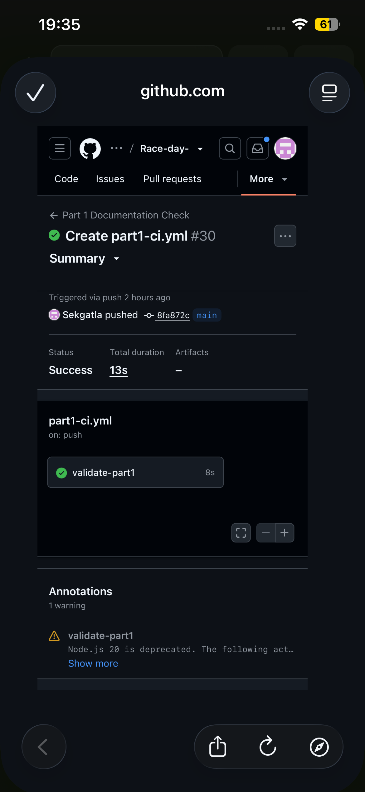

<div align="center">

<pre>
  ____                 ____
 |  _ \ __ _  ___ ___ |  _ \  __ _ _   _
 | |_) / _` |/ __/ _ \| | | |/ _` | | | |
 |  _ < (_| | (_| (_) | |_| | (_| | |_| |
 |_| \_\__,_|\___\___/|____/ \__,_|\__, |
                                    |___/
</pre>

**Event management and race results platform**

Part 1 · System planning and database design  
Part 2 · RESTful API development

[](https://github.com/Sekgatla/Race-day-/actions/workflows/part1-ci.yml) [](https://github.com/Sekgatla/Race-day-/actions/workflows/part2-ci.yml) [](docs/RaceDay_Database.sql)

</div>

---

## Table of contents

- [Overview](#overview)
- [User roles](#user-roles)
- [Part 1 evidence](#part-1-evidence)
- [Data model](#data-model)
- [Part 2 setup and run](#part-2-setup-and-run)
- [Authentication and sessions](#authentication-and-sessions)
- [API endpoints and Swagger](#api-endpoints-and-swagger)
- [Tests and CI/CD](#tests-and-cicd)
- [Video presentation](#video-presentation)
- [Repository layout](#repository-layout)
- [AI assistance disclosure](#ai-assistance-disclosure)

## Overview

> This folder contains the complete Part 2 implementation. Its GitHub Actions workflow is at the repository root in `../.github/workflows/part2-ci.yml`, where GitHub can detect and run it.

RaceDay replaces paper registrations, separate spreadsheets, and manual result tracking with one organised system for South African running, walking, and cycling events.

- **Part 1** planned the data model, documented the API, created the SQL Server script, and checked the documentation repository with GitHub Actions.
- **Part 2** implements the planned API with ASP.NET Core Web API, Entity Framework Core Code First, SQL Server, role enforcement, Swagger, automated tests, and GitHub Actions.
- **Part 3** will add the MVC application and Docker packaging.

## User roles

| Role | Responsibilities |
|:---|:---|
| **Organiser** | Manage owned events and categories, view enrolments, capture results, and maintain route and weather information. |
| **Participant** | Create an account, browse events, select a category, enrol, and view personal results. |

The API checks authentication, role, and event ownership before protected operations.

## Part 1 evidence

| Document | Purpose |
|:---|:---|
| [RaceDay ERD](docs/RaceDay_ERD.pdf) | Seven-entity relational design with keys, relationships, and cardinality. |
| [Editable ERD source](docs/RaceDay_ERD.dot) | Graphviz source for the ERD. |
| [API endpoint plan](docs/RaceDay_API_Endpoint_Plan.md) | HTTP methods, routes, roles, request bodies, and responses. |
| [API conventions](docs/RaceDay_API_Conventions.md) | Shared URL, response, validation, and security conventions. |
| [SQL database script](docs/RaceDay_Database.sql) | SQL Server schema, constraints, seed data, and verification queries. |

## Data model

The Part 1 domain schema contains seven entities:

- **Users** — organiser and participant accounts
- **Events** — events managed by organisers
- **Categories** — event divisions and entry options
- **Enrolments** — participant entries and selected categories
- **Results** — finish positions, times, and result status
- **Routes** — route information for events
- **EventWeather** — event forecasts and advisories

Enrolments resolves the many-to-many relationship between participants and events. Results are separate because participants enrol before completing an event. The Part 2 EF Core model keeps these seven domain entities and applies the submitted design through a Code First migration. The migration has been generated and its SQL script contains all seven tables; applying it to a real SQL Server still needs to be verified on a machine with SQL Server or LocalDB.

## Part 2 setup and run

### Requirements

- .NET 8 SDK
- SQL Server or SQL Server LocalDB
- Git

### Configure SQL Server

The default connection in `RaceDay.Api/appsettings.json` uses Windows LocalDB:

```text
Server=(localdb)\MSSQLLocalDB;Database=RaceDayDb;Trusted_Connection=True;TrustServerCertificate=True;MultipleActiveResultSets=true
```

To use another SQL Server instance, set `RACEDAY_SQLSERVER_CONNECTION` before starting the API. Example for SQL Server Express in PowerShell:

```powershell
$env:RACEDAY_SQLSERVER_CONNECTION = "Server=.\SQLEXPRESS;Database=RaceDayDb;Trusted_Connection=True;TrustServerCertificate=True;MultipleActiveResultSets=true"
```

Do not commit passwords or connection credentials to the repository.

### Run locally

Run these commands from this `Part 2/` directory, which contains `RaceDay.sln`.

```bash
dotnet tool restore
dotnet restore RaceDay.sln
dotnet ef database update --project RaceDay.Api --startup-project RaceDay.Api
dotnet run --project RaceDay.Api
```

The API also applies pending migrations at startup. In Visual Studio, set `RaceDay.Api` as the startup project and use Package Manager Console's `Update-Database` command if preferred.

### Replit preview

The Replit preview explicitly selects EF Core's in-memory provider because SQL Server LocalDB is not available in this Linux preview environment. It loads demo data but does not preserve changes across workflow restarts. For a persistent database, configure a SQL Server connection and run with the default `SqlServer` provider.

### Demo accounts

On an empty database, the API seeds two Organisers, two Participants, three Events, Categories, Routes, Weather forecasts, Enrolments, and Results. The demo password for all four seeded users is `RaceDay!2026`.

| Role | Email |
|:---|:---|
| Organiser | `lerato.mokoena@raceday.example` |
| Organiser | `james.naidoo@raceday.example` |
| Participant | `ayanda.dlamini@raceday.example` |
| Participant | `pieter.vanwyk@raceday.example` |

Seeded passwords are generated with ASP.NET Core Identity's password hasher. Plaintext passwords are not stored.

## Authentication and sessions

`POST /api/auth/login` returns an opaque bearer session token. The server stores a hash of the token alongside the user's ID, role, and 12-hour expiry. The API checks that the account is still active and that its role has not changed on each authenticated request. `POST /api/auth/logout` revokes the current session. Account passwords are hashed with ASP.NET Core Identity's `PasswordHasher<User>`.

Session state is held in memory so it does not add a security/session entity to the submitted seven-table Part 1 domain schema. Restarting the API clears sessions, so users need to log in again. The in-memory database and session store are for the development preview only; SQL Server is the default application database provider.

## API endpoints and Swagger

Swagger is available at `/api/swagger` in Development. Use the **Authorize** control with the token returned by login to test protected calls.

| Area | Routes |
|:---|:---|
| Authentication | `POST /api/auth/register`, `POST /api/auth/login`, `POST /api/auth/logout` |
| Profile | `GET /api/users/me`, `PUT /api/users/me` |
| Events | `GET /api/events`, `GET /api/events/{eventId}`, `GET /api/organiser/events`, `POST /api/events`, `PUT /api/events/{eventId}`, `DELETE /api/events/{eventId}` |
| Categories | `GET/POST /api/events/{eventId}/categories`, `PUT/DELETE /api/categories/{categoryId}` |
| Enrolments | `POST /api/events/{eventId}/enrolments`, `GET /api/enrolments/me`, `GET /api/enrolments/{enrolmentId}`, `GET /api/events/{eventId}/enrolments`, `PUT/DELETE /api/enrolments/{enrolmentId}` |
| Results | `POST /api/enrolments/{enrolmentId}/result`, `PUT /api/results/{resultId}`, `GET /api/results/me`, `GET /api/events/{eventId}/results`, `GET /api/results/{resultId}` |
| Route | `GET/PUT /api/events/{eventId}/route` |
| Weather | `GET/POST /api/events/{eventId}/weather` |

The implementation covers the 30 HTTP operations in the submitted plan (18 business route templates, plus a health check). Unauthenticated requests receive `401`; authenticated users with the wrong role or ownership receive `403`. Duplicate entries, capacity, event ownership, and result publishing rules are checked by the API.

## Tests and CI/CD

Run the automated tests locally from this directory:

```bash
dotnet test RaceDay.sln --configuration Release
```

The tests cover registration and password hashing, login/logout, invalid credentials, unauthenticated access, role and ownership restrictions, event creation, enrolment, result capture, seeded public endpoints, and Swagger.

GitHub Actions is configured in [Part 2 GitHub Actions workflow](../.github/workflows/part2-ci.yml) to restore, build, and test the solution on pushes and pull requests to `main`.

### Part 1 CI screenshot

This is the successful Part 1 workflow screenshot supplied with the submission:

<p align="center">
  
</p>

### Part 2 CI screenshot

> Add a screenshot of the successful `part2-ci.yml` GitHub Actions run before submission. Do not use the Part 1 image as Part 2 evidence.

The assessment requires at least 20 meaningful Part 2 commits. Commit genuine implementation milestones to the GitHub repository as work progresses; do not manufacture commits to meet the count.

## Video presentation

### Part 1

The Part 1 presentation explains the repository, ERD decisions, API plan, SQL design, live SSMS execution, seeded data, and the successful CI build.

> **Unlisted YouTube link:** https://youtu.be/SWQssPZqI5k

### Part 2

Add the unlisted Part 2 video after recording a voiceover demonstration of the API, Swagger, authentication, role restrictions, tests, and CI build.

> **Unlisted YouTube link:** ADD-PART-2-VIDEO-LINK-BEFORE-SUBMISSION

## Repository layout

```text
Part 2/
├── README.md
├── RaceDay.sln
├── RaceDay.Api/
│   ├── Controllers/
│   ├── Data/
│   │   └── Migrations/
│   ├── Models/
│   └── Security/
├── RaceDay.Contracts/
├── RaceDay.Api.Tests/
└── docs/
    ├── RaceDay_ERD.pdf
    ├── RaceDay_API_Endpoint_Plan.md
    ├── RaceDay_Database.sql
    └── RaceDay_API_Conventions.md
```

The CI workflow for this folder is at `../.github/workflows/part2-ci.yml`; GitHub only detects workflows in the repository-root `.github/workflows/` directory.

## AI assistance disclosure

Replit Agent assisted with planning, initial implementation, tests, and documentation for Part 2. Review and adapt the work, make sure you can explain it, and disclose AI use as required by the IIE assessment rules before submitting.

## References

Google, 2026. Gemini (Large language model). Available at: https://gemini.google.com  
Graphviz, 2026. Graphviz - Graph Visualization Software. Available at: https://graphviz.org/.  
Lucid Software Inc., 2026. Lucidchart diagramming application. Available at: https://www.lucidchart.com.  
Microsoft, 2026a. GitHub Actions Documentation. Available at: https://docs.github.com/en/actions.  
Microsoft, 2026b. Microsoft Visio. Available at: https://www.microsoft.com/en-us/microsoft-365/visio/flowchart-software.

The Part 1 README disclosed Google Gemini assistance for formatting, Markdown structure, and citations. The Part 2 disclosure above records Replit Agent assistance. Update declarations if other AI tools are used.
