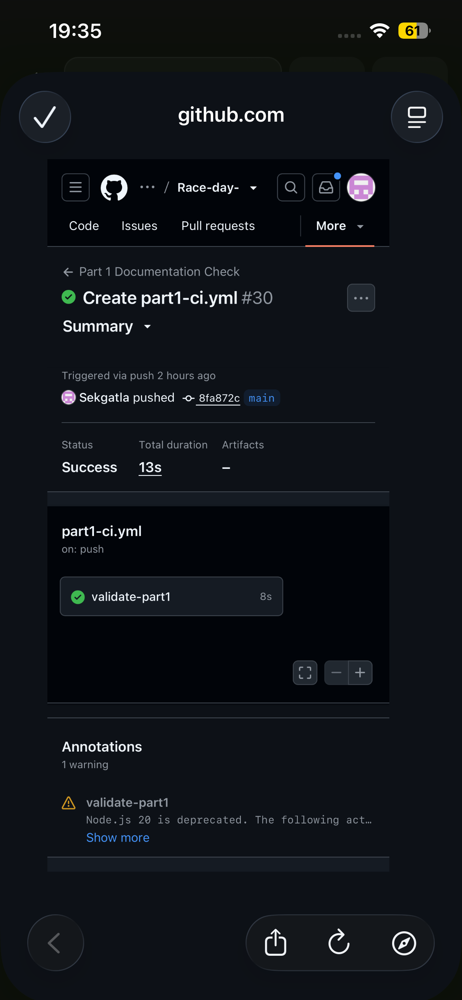
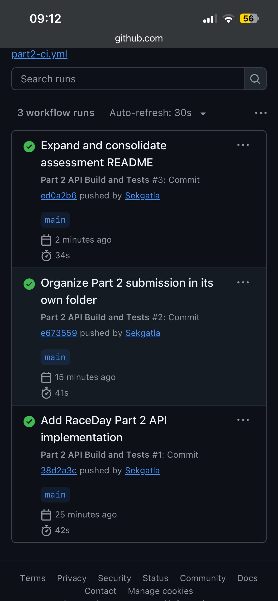
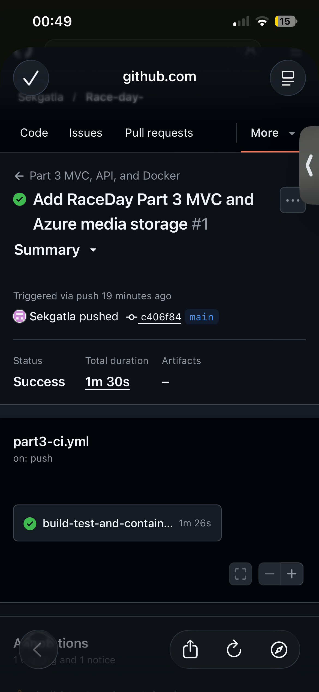

<div align="center">
<h1>🏃 RaceDay</h1>
<p><strong>Event management and race results for South African road events</strong><br>PROG6212 · Programming 2B · Portfolio of Evidence</p>
<p>
<a href="https://github.com/Sekgatla/Race-day-/actions/workflows/part1-ci.yml"></a>
<a href="https://github.com/Sekgatla/Race-day-/actions/workflows/part2-ci.yml"></a>
<a href="https://github.com/Sekgatla/Race-day-/actions/workflows/part3-ci.yml"></a>


</p>
</div>

---

## Contents
- [Project Description](#project-description)
- [User Roles](#user-roles)
- [Part 1: System Planning](#part-1-system-planning)
- [Part 2: RESTful API](#part-2-restful-api)
  - [Technologies Used](#technologies-used)
  - [Repository Structure](#repository-structure)
  - [Database Setup](#database-setup)
  - [How to Run the API](#how-to-run-the-api)
  - [Authentication](#authentication)
  - [API Endpoints](#api-endpoints)
  - [Swagger](#swagger)
  - [Unit Testing](#unit-testing)
  - [CI/CD](#cicd)
  - [GitHub Actions Screenshot](#github-actions-screenshot)
  - [Video Presentation](#video-presentation)
- [Part 3: ASP.NET Core MVC Application](#part-3-aspnet-core-mvc-application)
  - [User workflows](#user-workflows)
  - [Run the application](#run-the-application)
  - [Azure Blob Storage](#azure-blob-storage)
  - [Docker](#docker)
  - [Part 3 CI](#part-3-ci)
  - [Part 3 video presentation](#part-3-video-presentation)
- [AI Assistance and References](#ai-assistance-and-references)

## Project Description
RaceDay is a web-based event management system for South African road running, walking, and cycling events. It replaces paper registrations, disconnected spreadsheets, and manual result tracking with one API-backed platform.

The Portfolio of Evidence is built in stages: **Part 1** plans the data model and API, **Part 2** implements the RESTful API, and **Part 3** adds the ASP.NET Core MVC web application, Docker packaging, and image-storage integration. The MVC application consumes the Part 2 API; it does not connect to the database directly.

## User Roles
| Role | Responsibilities |
|:---|:---|
| **Organiser** | Manage owned events and categories, view enrolments, record results, and maintain event route and weather information. |
| **Participant** | Create an account, browse events, choose a category, enrol, and view personal results. |

The API checks authentication, role, and event ownership before protected operations.

## Part 1: System Planning
Part 1 planning evidence remains in the repository-root [`docs/`](docs/) folder. These documents are the specification for Part 2.

| Evidence | File |
|:---|:---|
| Entity Relationship Diagram | [RaceDay_ERD.pdf](docs/RaceDay_ERD.pdf) · [editable Graphviz source](docs/RaceDay_ERD.dot) |
| API endpoint plan | [RaceDay_API_Endpoint_Plan.md](docs/RaceDay_API_Endpoint_Plan.md) |
| SQL database design | [RaceDay_Database.sql](docs/RaceDay_Database.sql) |
| Part 1 CI screenshot | [ci-green-build.png](docs/ci-green-build.png) |
| Part 1 video | [Unlisted presentation](https://youtu.be/SWQssPZqI5k) |

The domain model contains seven entities: Users, Events, Categories, Enrolments, Results, Routes, and EventWeather. Enrolments connects participants, events, and selected categories; a result is recorded after an enrolment is completed.

## Part 2: RESTful API
The complete Part 2 source, tests, migration, and supporting documents are grouped in [`Part 2/`](Part%202/). The Part 2 workflow remains under the repository-root `.github/workflows/` folder so GitHub can detect it; it builds the solution from `Part 2/`.

### Technologies Used
| Area | Technology |
|:---|:---|
| API | ASP.NET Core Web API on .NET 8 |
| Data access | Entity Framework Core Code First |
| Database | Microsoft SQL Server / LocalDB |
| API documentation | Swagger / OpenAPI |
| Testing | xUnit and ASP.NET Core integration-test host |
| CI/CD | GitHub Actions |

### Repository Structure
```text
Race-day-/
├── README.md                         # Project overview and submission guide
├── docker-compose.yml                # Runs the API and MVC containers
├── docs/                             # Part 1 planning and CI evidence
├── Part 2/                           # REST API, shared contracts, and tests
│   ├── RaceDay.sln                   # Combined API and MVC solution
│   ├── RaceDay.Api/                  # API, data access, and security
│   ├── RaceDay.Contracts/            # Shared request and response DTOs
│   ├── RaceDay.Api.Tests/            # Automated API integration tests
│   └── docs/                         # Part 2 supporting design documents
├── Part 3/                           # MVC application and image-storage scripts
│   └── RaceDay.Mvc/                  # Controllers, views, and web services
└── .github/workflows/                # Part 1, Part 2, and Part 3 CI workflows
```

### Database Setup
The default connection in `Part 2/RaceDay.Api/appsettings.json` targets Windows SQL Server LocalDB:

```text
Server=(localdb)\MSSQLLocalDB;Database=RaceDayDb;Trusted_Connection=True;TrustServerCertificate=True;MultipleActiveResultSets=true
```

To use another SQL Server instance, set `RACEDAY_SQLSERVER_CONNECTION` before starting the API. Example in PowerShell:

```powershell
$env:RACEDAY_SQLSERVER_CONNECTION = 'Server=.\SQLEXPRESS;Database=RaceDayDb;Trusted_Connection=True;TrustServerCertificate=True;MultipleActiveResultSets=true'
```

Do not commit database passwords or other credentials. The EF Core migration is included in `Part 2/RaceDay.Api/Data/Migrations/`. After configuring SQL Server or LocalDB, apply it and confirm the database tables exist:

```bash
cd "Part 2"
dotnet tool restore
dotnet restore RaceDay.sln
dotnet ef database update --project RaceDay.Api --startup-project RaceDay.Api
```

The test project uses an in-memory provider for automated tests; a passing CI run does not by itself verify a separate local SQL Server installation.

### How to Run the API
From the repository root:

```bash
cd "Part 2"
dotnet tool restore
dotnet restore RaceDay.sln
dotnet run --project RaceDay.Api
```

The API also applies pending migrations at startup. In Visual Studio, open `Part 2/RaceDay.sln` and set `RaceDay.Api` as the startup project.

### Authentication
RaceDay supports Organiser and Participant registration and login. Passwords are hashed with ASP.NET Core Identity's `PasswordHasher<User>`; plaintext passwords are not stored. Login returns an opaque bearer session token. The server stores a hash of the token with the user's ID, role, and expiry, and logout revokes the session.

Session state is held in memory and is cleared when the API restarts, so users must log in again after a restart. Role and ownership checks restrict Organiser-only and Participant-only actions. Unauthenticated protected requests return `401`; authenticated requests with the wrong role or ownership return `403`.

For an empty development database, the API seeds demo Organiser and Participant accounts. The demo password is `RaceDay!2026`; do not reuse it for real accounts.

### API Endpoints
| Area | Routes |
|:---|:---|
| Authentication | `POST /api/auth/register`, `POST /api/auth/login`, `POST /api/auth/logout` |
| Profile | `GET /api/users/me`, `PUT /api/users/me` |
| Events | `GET /api/events`, `GET /api/events/{eventId}`, `GET /api/organiser/events`, `POST /api/events`, `PUT /api/events/{eventId}`, `DELETE /api/events/{eventId}` |
| Categories | `GET/POST /api/events/{eventId}/categories`, `PUT/DELETE /api/categories/{categoryId}` |
| Enrolments | `POST /api/events/{eventId}/enrolments`, `GET /api/enrolments/me`, `GET /api/enrolments/{enrolmentId}`, `GET /api/events/{eventId}/enrolments`, `PUT/DELETE /api/enrolments/{enrolmentId}` |
| Results | `POST /api/enrolments/{enrolmentId}/result`, `PUT /api/results/{resultId}`, `GET /api/results/me`, `GET /api/events/{eventId}/results`, `GET /api/results/{resultId}` |
| Routes | `GET/PUT /api/events/{eventId}/route` |
| Weather | `GET/POST /api/events/{eventId}/weather` |

The API checks event ownership, duplicate entries, capacity, and result-publishing rules. The Part 1 endpoint plan remains the reference; explain any deliberate deviations before submission.

### Swagger
In Development, open `/api/swagger` after starting the API. Use Swagger's **Authorize** control with the bearer token returned by login to test protected calls. Demonstrate a complete flow: register, log in, create an event and categories, enrol as a Participant, view enrolments, record a result, and view personal results.

### Unit Testing
Run the test suite from the repository root:

```bash
cd "Part 2"
dotnet test RaceDay.sln --configuration Release
```

Tests cover registration and password hashing, login and logout, invalid credentials, unauthenticated requests, role and ownership restrictions, event creation, enrolment, result capture, seeded public endpoints, and Swagger. They include successful and rejected-access scenarios.

### CI/CD
The [Part 2 GitHub Actions workflow](.github/workflows/part2-ci.yml) runs on pushes and pull requests to `main`. It restores, builds, and tests `Part 2/RaceDay.sln`. GitHub requires workflow files to live in the repository-root `.github/workflows/` directory.

[](https://github.com/Sekgatla/Race-day-/actions/workflows/part2-ci.yml) · [View workflow runs](https://github.com/Sekgatla/Race-day-/actions/workflows/part2-ci.yml)

The assessment guide requires at least **20 meaningful Part 2 commits**. Keep genuine implementation milestones in the history; do not manufacture filler commits.

### GitHub Actions Screenshot
The repository includes screenshots of successful Part 1 and Part 2 workflow runs:







For the latest Part 3 build and Docker image checks, use the Part 3 workflow badge above.


### Video Presentation
The presentations should show the running API and explain the code and design decisions. The Part 2 guide expects a voiceover walkthrough of the repository, data model, authentication, role restrictions, Swagger, tests, and green CI build.

- **Part 1:** [Unlisted presentation](https://youtu.be/SWQssPZqI5k)
- **Part 2:** [Unlisted presentation](https://youtu.be/auyjNdyknvE?si=6pTxgPs6vYDiLbkX)
- **Part 3:** Add your unlisted video link here.

## Part 3: ASP.NET Core MVC Application

Part 3 adds an MVC web application that consumes the Part 2 REST API. It does not access the database directly or duplicate API business rules.

### User workflows

| Role | Available workflows |
|:---|:---|
| **Organiser** | View an event dashboard, create and edit events, manage event categories, review enrolments, capture results, and upload event banners. |
| **Participant** | Browse and filter events, view event details, enrol in a category, review enrolments and results, edit a profile, and upload a profile picture. |

Both roles sign in through the API. The MVC app keeps the bearer token in server-side session storage and presents role-appropriate navigation. The API remains responsible for authentication, event ownership, validation, and persistence.

### Run the application

The preview script builds the solution and starts the API and MVC site together. From the repository root, run it in Bash (for example, Git Bash or WSL on Windows):

```bash
bash "Part 3/start-preview.sh"
```

**Visual Studio:** open `Part 2/RaceDay.sln` and run `RaceDay.Mvc` with the `http` launch profile; the MVC site opens at <http://localhost:5076>. The MVC app expects the Part 2 API at `http://localhost:5247/`, matching the API project's `http` launch profile, so start the API as well.

**Bash preview:** `bash "Part 3/start-preview.sh"` starts the API on port 5001 and the MVC site on port 3000; open <http://localhost:3000>.

The development preview uses the API's in-memory database and local image storage. Seeded sample accounts use the demo password shown in the API authentication section above. Data in the in-memory database resets when the API restarts.

To build or test the full solution:

```bash
dotnet tool restore --tool-manifest "Part 2/.config/dotnet-tools.json"
dotnet build "Part 2/RaceDay.sln" --configuration Release
dotnet test "Part 2/RaceDay.sln" --configuration Release
```

### Azure Blob Storage

The Part 2 API owns all image upload and retrieval routes. In production, set:

- `RACEDAY_MEDIA_PROVIDER=Azure`
- `AZURE_STORAGE_CONNECTION_STRING` as a Replit Secret or deployment secret
- `AZURE_STORAGE_CONTAINER` optionally; the default container is `raceday-media`
- `RACEDAY_SQLSERVER_CONNECTION` as a production secret for the API's SQL Server connection

The API rejects uploads over 5 MB and accepts PNG, JPEG, and WebP images after checking their file signatures. Images are private in the storage account and are streamed through authenticated or public API routes as appropriate. The MVC app never receives the Azure connection string.

Development and Docker Compose explicitly use local file storage so the app can run without cloud credentials. The `docker compose up --build` demo uses an in-memory database and is not a durable production deployment. Replit production startup requires both the SQL Server and Azure secrets; it stops with a clear error if either is missing.

### Docker

Run the API and MVC containers together from the repository root:

```bash
docker compose up --build
```

Open `http://localhost:8080`. Separate multi-stage Dockerfiles are provided for the API and MVC application. To use production SQL Server and Azure Blob Storage, configure the provider and connection-string environment variables rather than the in-memory/local demo settings.

### Part 3 CI

The [Part 3 GitHub Actions workflow](.github/workflows/part3-ci.yml) restores and builds the combined solution, runs API integration tests, and uses Docker Compose to build and start the API and MVC containers. Its smoke test checks that the MVC home page can reach the API, then stops the containers. It does not exercise authenticated Organiser/Participant workflows or verify a live Azure upload.

[](https://github.com/Sekgatla/Race-day-/actions/workflows/part3-ci.yml) · [View Part 3 workflow runs](https://github.com/Sekgatla/Race-day-/actions/workflows/part3-ci.yml)

The assessment requires at least **20 meaningful commits** for Part 3. Make genuine commits as the work progresses; do not create filler commits or rewrite the history to make it appear that work happened earlier.

### Part 3 video presentation

Add the unlisted YouTube link for the Part 3 demonstration here before submission. The video should show the running MVC application, explain how it consumes the API, demonstrate organiser and participant workflows, and show the Azure Blob Storage and Docker setup. htyyy

## AI Assistance and References
Replit Agent assisted with planning,   and documentation for Part 2. 

- Google (2026), Gemini. https://gemini.google.com
- Graphviz (2026), Graphviz — Graph Visualization Software. https://graphviz.org/
- Lucid Software (2026), Lucidchart. https://www.lucidchart.com/
- Microsoft (2026), GitHub Actions documentation. https://docs.github.com/en/actions
- Microsoft (2026), Visio. https://www.microsoft.com/en-us/microsoft-365/visio/flowchart-software
